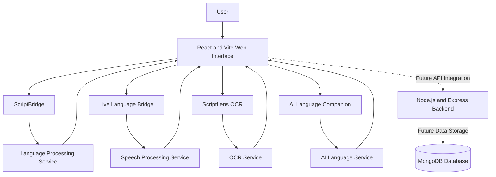

# Lingify — Technical Design Document

**Project:** Lingify  
**Document Version:** 1.0  
**Status:** Initial Design — Features Under Development

## 1. Introduction

Lingify is a multilingual language accessibility platform designed to reduce communication barriers between people who use different languages and writing systems.

The platform aims to provide transliteration, voice-based input, OCR-based text extraction, and AI-assisted language support through a simple web interface.

This document describes the proposed architecture, components, data flow, technology stack, security considerations, and testing approach.

## 2. Objectives

- Help users convert text between supported writing systems.
- Explore voice input for multilingual communication.
- Extract text from uploaded images using OCR.
- Provide AI-assisted language support.
- Offer a simple and accessible user interface.
- Allow future integration of a backend and database.

## 3. System Architecture

The following diagram represents the **proposed architecture**. Some components are planned and may not yet be implemented.



### Architecture Explanation

1. **Presentation Layer:** React components provide navigation, input fields, results, and user interactions.
2. **Language Processing Layer:** Handles transliteration and language conversion through suitable language-processing logic or services.
3. **Speech Processing Layer:** Intended to support speech input and, where implemented, speech output.
4. **OCR Layer:** Intended to extract text from uploaded images.
5. **AI Layer:** Intended to provide language assistance using an appropriate model or API.
6. **Backend Layer:** A planned Node.js and Express.js service for handling API requests and application logic.
7. **Database Layer:** A planned MongoDB database for storing supported application data, such as user preferences, if required.

## 4. Technology Stack

| Component | Technology | Purpose |
|---|---|---|
| Frontend | React.js | User interface |
| Development server | Vite | Local development and build |
| Styling | CSS | Layout and visual design |
| Programming language | JavaScript | Application logic |
| Backend (planned) | Node.js | Server-side runtime |
| API framework (planned) | Express.js | Backend endpoints |
| Database (planned) | MongoDB | Persistent application data |
| Version control | Git and GitHub | Source control and collaboration |

Additional OCR, speech, and AI services will be selected based on accuracy, language coverage, cost, privacy, and integration requirements.

## 5. Main Modules

### 5.1 ScriptBridge

**Purpose:** Help users convert text from one supported writing system to another.

**Inputs:** Source text and selected language or script options.

**Processing:** Apply an appropriate transliteration engine or language-processing service.

**Output:** Converted text displayed to the user.

**Important:** Transliteration changes the writing system; it does not necessarily translate the meaning of a sentence.

### 5.2 Live Language Bridge

**Purpose:** Explore voice-based multilingual communication.

**Proposed workflow:**
1. User provides voice input.
2. A speech-recognition service converts speech into text.
3. Language processing is applied if required.
4. The resulting text is displayed.

Speech recognition and audio playback depend on the selected services and their implementation.

### 5.3 ScriptLens

**Purpose:** Extract text from an image.

**Proposed workflow:**
1. User selects an image.
2. The application validates the file.
3. An OCR engine processes the image.
4. Extracted text is displayed for review.

### 5.4 AI Language Companion

**Purpose:** Provide language-related assistance, such as rewriting, grammar suggestions, or explanations.

This module will require a suitable AI model or API before it can provide AI-generated responses.

### 5.5 My Language Memory

**Purpose:** Allow users to save useful content and language preferences.

Persistent storage and user authentication may be introduced through a backend and database in a future implementation.

## 6. Data Flow

A typical text-processing workflow is:

1. The user enters text through the React interface.
2. The frontend validates the input.
3. The application processes the text locally or sends it to the appropriate service.
4. The processing service returns a result.
5. The frontend displays the result and any relevant error messages.

For future backend integration, requests will pass through an API layer. The backend will validate inputs, handle service integrations, and access the database when necessary.

## 7. API Design — Proposed

The following endpoints are examples for a future Express.js backend. They are not claims about currently implemented endpoints.

| Method | Proposed endpoint | Purpose |
|---|---|---|
| POST | `/api/transliterate` | Process text for transliteration |
| POST | `/api/voice/transcribe` | Process voice input |
| POST | `/api/ocr` | Extract text from an image |
| POST | `/api/assistant` | Request language assistance |
| GET | `/api/preferences` | Retrieve saved user preferences |

Request and response formats will be finalized when these endpoints are implemented.

## 8. Security and Privacy

- Validate text inputs and uploaded files.
- Restrict accepted file types and file sizes for image uploads.
- Never expose private API keys or database credentials in frontend code.
- Store server-side secrets in environment variables.
- Configure `.gitignore` to exclude `.env` files and dependencies.
- Use HTTPS in production.
- Apply authentication and authorization if personal data is stored.
- Avoid retaining voice recordings or uploaded documents longer than necessary.
- Explain how external services process user data before integrating them.

## 9. Error Handling

The application should handle:

- Empty text input.
- Unsupported languages or scripts.
- Invalid or oversized image files.
- Speech-recognition failures.
- Network errors and unavailable services.
- Invalid API responses.
- Database connection failures, if a database is integrated.

Errors should be displayed in clear language without exposing sensitive technical details.

## 10. Testing Strategy

Planned testing includes:

- **Functional testing:** Verify each implemented feature.
- **Input validation:** Test empty inputs, unsupported scripts, and invalid files.
- **Integration testing:** Verify frontend and backend communication when available.
- **API testing:** Check request validation, response formats, and error codes.
- **Security testing:** Check secret handling, upload validation, and access control.
- **Usability testing:** Check navigation, readability, keyboard access, and mobile responsiveness.

Representative sample data and test cases will be maintained in a separate repository document.

## 11. Deployment Plan

### Development

Run the Vite development server locally using:

```bash
npm install
npm run dev
```

### Production

1. Build the frontend using `npm run build`.
2. Deploy the generated frontend build to a suitable hosting service.
3. Deploy the backend separately if it is implemented.
4. Configure production environment variables securely.
5. Configure HTTPS, access controls, and monitoring as required.

## 12. Current Status and Future Work

The React and Vite frontend is being developed. The final architecture will depend on which features are implemented and which external services are selected.

Future work includes:

- Implementing and evaluating transliteration support.
- Integrating voice recognition and OCR.
- Integrating an AI language service.
- Adding backend APIs and persistent storage where necessary.
- Expanding supported languages.
- Testing performance, usability, and privacy.

## 13. Conclusion

Lingify aims to make multilingual digital communication more accessible through a modular web architecture. Its design supports gradual development, allowing features to be implemented, tested, and integrated as the project progresses.

**Document status:** Proposed technical design; update this document as implementation decisions and working features evolve.
